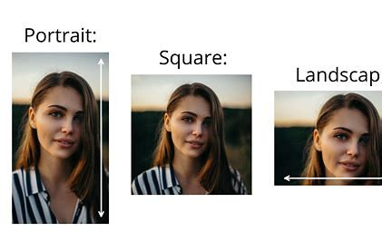

# Media orientations
You can check the current orientationby accessing `orientation`

| value | desccription |
| ----- | ------------ |
| `landscape`| `horizontal positioning` |
| `portrait` | `vertical positioning` |

## example
See [example/ex3 -- annotations/ex3_2 -- @media/@media ex4.css]()